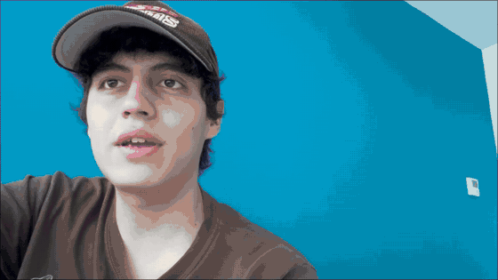
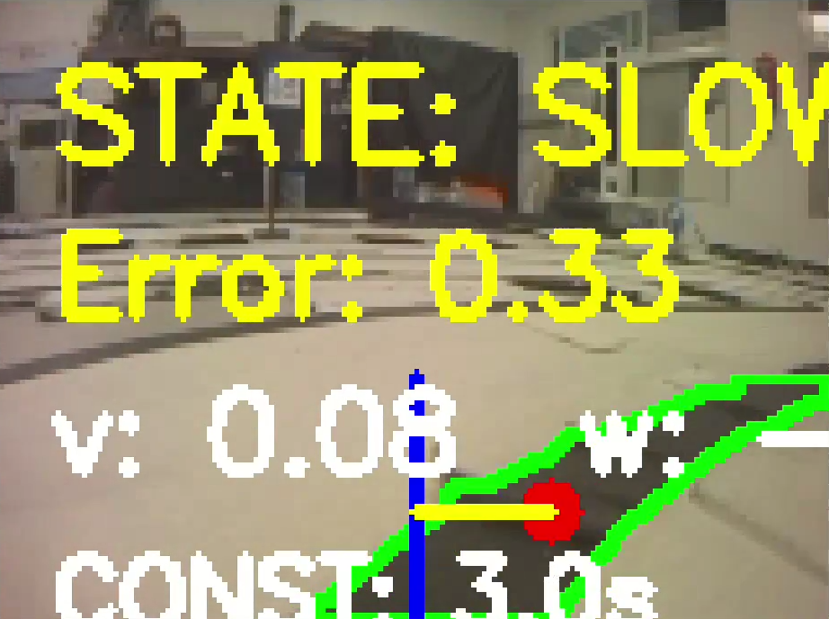
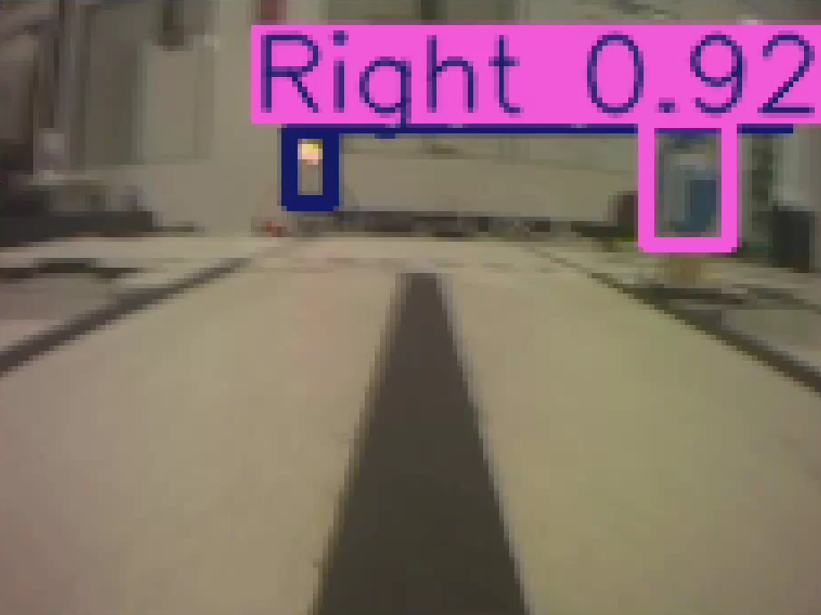
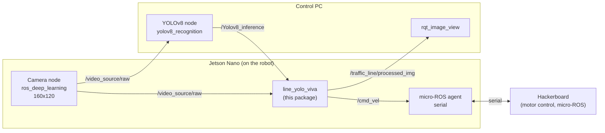

# PuzzleBot Autonomous Navigation

Autonomous navigation for the Manchester Robotics **PuzzleBot** on a scaled street course: line following with OpenCV, traffic light and road sign detection with a custom-trained **YOLOv8** model, and a ROS 2 control node that merges both into velocity commands for the robot.

Built for the Manchester Robotics Final Challenge in the Robotics and Digital Systems Engineering program at Tecnológico de Monterrey, Campus Querétaro (6th semester, 2026).



| Line following (`/traffic_line/processed_img`) | YOLOv8 detections (`/Yolov8_inference`) |
| --- | --- |
|  |  |

## What the robot does

- Follows a black line using an HSV mask on the lower part of the camera image and a proportional controller on the line's centroid.
- Reacts to traffic lights: stops on red and waits for green, slows down on yellow.
- Reacts to road signs: Stop, Construction, Give Way, and the direction signs Left, Right and Straight.
- Executes timed maneuvers at intersections (drive forward, turn 90°, drive forward) and pauses them if a red light appears in the middle of the maneuver.
- Publishes a debug image with the detected line, the steering error, the current state and the active signals.

## System architecture

The system runs on two machines connected over WiFi. The Jetson Nano on the robot handles the camera, motor control and the control logic. A PC runs the YOLOv8 inference to keep the load off the Jetson.



| Topic | Type | Publisher | Subscriber |
| --- | --- | --- | --- |
| `/video_source/raw` | `sensor_msgs/Image` | camera node | `line_yolo_viva`, YOLOv8 node |
| `/Yolov8_inference` | `yolo_msg/Yolov8Inference` | YOLOv8 node | `line_yolo_viva` |
| `/cmd_vel` | `geometry_msgs/Twist` | `line_yolo_viva` | micro-ROS agent → hackerboard |
| `/traffic_line/processed_img` | `sensor_msgs/Image` | `line_yolo_viva` | `rqt_image_view` |

## How the control node works

The node `traffic_line` (executable `line_yolo_viva`) runs a 10 Hz control loop. Each cycle it reads the latest camera frame and the latest YOLO detections, and publishes one velocity command.

### Line following

1. Gaussian blur and conversion to HSV.
2. Region of interest: the bottom 40% of the image (`roi_start_ratio = 0.60`).
3. Black mask with `inRange` (V ≤ 110), cleaned with a 5×5 morphological open and close.
4. Largest contour above `min_line_area` (300 px²), and its centroid from image moments.
5. Proportional control on the normalized horizontal error:
   `ω = -1.2 · (cx - w/2) / (w/2)`, limited to ±1.2 rad/s, at a base speed of 0.10 m/s.

If no line is visible, the robot stops (or keeps creeping forward at half speed while a yellow light, Construction or Give Way is active).

### Behavior per detection

Detections are only used while YOLO data is fresh (less than 1 s old) and the bounding box is large enough, so far-away objects are ignored. The same sign cannot trigger again within a 15 s cooldown.

| Class | Behavior |
| --- | --- |
| `Red` | Stop and wait for green. A running maneuver is paused and resumed later with its timing preserved. |
| `Yellow` | Half speed. |
| `Green` | Release the stop and continue. |
| `Stop` | Stop for 10 s and cancel any stored or running maneuver. |
| `Construction` | Half speed for 10 s. |
| `Give Way` | Half speed for 5 s. |
| `Right` / `Left` | Store the maneuver, then drive forward 4.2 s, turn 90° in place, drive forward 1.0 s. |
| `Straight` | Store the maneuver, then drive forward 6 s through the intersection. |

The turn time is computed from the angular speed: `t = (π/2) / ω · turn_compensation`.

### Detection model

YOLOv8 (Ultralytics) trained on our own dataset, built and labeled on Roboflow from photos taken on the track with the robot's camera. It detects the three traffic light states (`Red`, `Yellow`, `Green`) and six sign classes (`Stop`, `Construction`, `Give Way`, `Right`, `Left`, `Straight`).

Priority order in each cycle: red light or Stop → paused maneuver → running maneuver → stored maneuver → line following.

### Parameters

All of these are ROS 2 parameters and are re-read every cycle, so they can be tuned live with `ros2 param set`.

| Parameter | Default | Meaning |
| --- | --- | --- |
| `black_h_low` … `black_v_high` | 0, 0, 0 / 180, 255, 110 | HSV range for the black line |
| `roi_start_ratio` | 0.60 | Where the line ROI starts (fraction of image height) |
| `min_line_area` | 300 | Minimum contour area to accept a line |
| `min_detection_area` | 280 | Minimum bounding box area for signs |
| `traffic_light_min_area` | 150 | Minimum bounding box area for traffic lights |
| `sign_cooldown` | 15.0 s | Time before the same sign can trigger again |
| `maneuver_linear_speed` | 0.11 m/s | Forward speed during maneuvers |
| `maneuver_angular_speed` | 0.8 rad/s | Turning speed during maneuvers |
| `straight_signal_duration` | 6.0 s | Forward time for `Straight` |
| `turn_forward_before_duration` | 4.2 s | Forward time before turning |
| `turn_forward_after_duration` | 1.0 s | Forward time after turning |
| `turn_compensation` | 0.95 | Correction factor for the 90° turn time |
| `traffic_light_persist_time` | 1.0 s | How long the last light state is kept when the light leaves the frame |

Example:

```bash
ros2 param set /traffic_line black_v_high 90
```

## Running it

### Requirements

- PuzzleBot with Jetson Nano, Raspberry Pi camera (CSI) and hackerboard connected over serial.
- PC with Ubuntu and ROS 2 Humble, on the same WiFi network and `ROS_DOMAIN_ID` as the Jetson.
- Python dependencies: `rclpy`, `cv_bridge`, OpenCV, NumPy, `ultralytics`.
- Other packages in the workspace: `micro_ros_agent`, `ros_deep_learning`, `yolov8_ros2` (inference node) and `yolo_msg` (message definitions), plus the trained `best.pt` model on the PC.

> This repository contains the control package `puzzlebot_line`. The YOLOv8 inference node, the `yolo_msg` package and the model weights are not included. `yolo_msg/Yolov8Inference` is expected to carry a list `yolov8_inference` of detections with `class_name`, `top`, `left`, `bottom` and `right`.

### Build

```bash
cd ~/ros2_ws/src
git clone https://github.com/glascurain4/puzzlebot-autonomous-nav.git
cd ~/ros2_ws
colcon build --packages-select puzzlebot_line
source install/setup.bash
```

### Launch order

On the **Jetson Nano** (three terminals over SSH, or tmux):

```bash
# 1. micro-ROS agent (bridge to the hackerboard)
ros2 run micro_ros_agent micro_ros_agent serial --dev /dev/ttyACM0

# 2. Camera
ros2 launch ros_deep_learning video_source.ros2.launch input_width:=160 input_height:=120

# 3. Control node (launch last)
ros2 run puzzlebot_line line_yolo_viva
```

On the **PC**:

```bash
# YOLOv8 inference
ros2 run yolov8_ros2 yolov8_recognition

# Debug view: subscribe to /traffic_line/processed_img
ros2 run rqt_image_view rqt_image_view
```

### Checking that it works

```bash
ros2 topic list      # /video_source/raw, /Yolov8_inference, /cmd_vel, /traffic_line/processed_img
ros2 topic echo /cmd_vel
```

With a line in view and no red light, `linear.x` and `angular.z` should be non-zero.

### Troubleshooting

- **Serial port:** the hackerboard can show up as `/dev/ttyUSB0` instead of `/dev/ttyACM0`. Check with `ls /dev/tty*`.
- **No topics on the PC:** make sure both machines share the network and `ROS_DOMAIN_ID`, and that no firewall blocks DDS multicast.
- **Late reactions to signs:** YOLO runs on the PC, so weak WiFi adds latency between detection and action.
- **Jetson lag:** avoid running a desktop or browser on the Jetson during runs.

## Testing

We tested on the official Manchester Robotics track (straights, curves, intersections, traffic lights and signs), recording the robot and the processed image stream side by side.

| Test | Success criterion |
| --- | --- |
| Line following on straights and curves | No line departure |
| Sign detection and maneuver | Correct maneuver for each of the 6 sign types |
| Traffic light compliance | No traffic light violations |
| Pause and resume | A maneuver interrupted by a red light completes correctly after green |
| Full lap | Complete lap with no human intervention |

The robot completed the track autonomously, with no external intervention during the run.

## Limitations and future work

- The controller is proportional only, so some steady-state error is possible. Next step: PID tuning.
- Speed is fixed per state and does not adapt to curvature.
- One monocular camera, no sensor fusion.
- Intersection turns are timed (open loop). Fusing wheel odometry would make them closed loop.

## Repository structure

```
puzzlebot-autonomous-nav/
├── puzzlebot_line/              # ROS 2 package (ament_python)
│   ├── puzzlebot_line/
│   │   └── traffic_line.py      # control node: line following + YOLO logic
│   ├── package.xml
│   ├── setup.py
│   └── test/                    # ament lint tests
└── docs/img/                    # screenshots
```

## Team

- Gabriel Lascurain
- José Vivanco
- César Nuño

Robotics and Digital Systems Engineering, Tecnológico de Monterrey, Campus Querétaro, in collaboration with Manchester Robotics.

Thanks to our professor Jesús Arturo Escobedo for his guidance, and to Manchester Robotics for the challenge.

## License

MIT, see [LICENSE](LICENSE).
